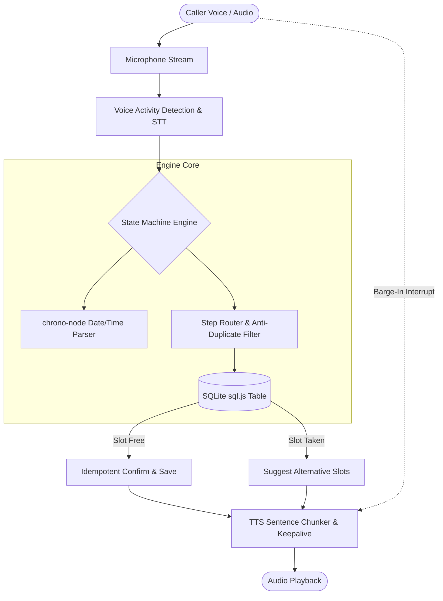

# 📞 CallFlow AI — Autonomous AI Phone Receptionist

[](https://reactjs.org/)
[](https://www.typescriptlang.org/)
[](https://vitejs.dev/)
[](https://sqlite.org/)
[](LICENSE)

An intelligent, hands-free voice receptionist web application designed for appointment-driven businesses (featuring **Glow & Grace Salon**). Built with React, TypeScript, a WebAssembly-powered SQLite database, natural language datetime parsing, and continuous speech interaction with barge-in support.

---

## ✨ Highlights & Key Features

### 🎙️ Hands-Free Voice Interaction (Zero "Push-to-Talk")
- **Continuous Voice Activity Detection (VAD)**: The caller speaks naturally without clicking or holding any buttons.
- **Instant Barge-In**: Interrupt the AI assistant at any time—speech synthesis terminates immediately, and the bot prioritizes the user's voice.
- **Echo & Feedback Suppression**: Filters speaker bleed and applies post-speech cooldown windows.
- **Natural Neural TTS**: Automatic selection of high-fidelity female voices (e.g. Edge Natural / Google UK English Female) at a clean 1.0x rate with sentence chunking and keepalive timers to eliminate browser speech cut-offs.

### 🧠 Robust State-Driven Booking Engine
- **Strict Turn-Based Architecture**: Eliminates infinite confirmation loops and hallucinated steps.
  $$\text{Book} \longrightarrow \text{Service} \longrightarrow \text{Date / Time} \longrightarrow \text{Name} \longrightarrow \text{Phone (10 digits)} \longrightarrow \text{Read-Back} \longrightarrow \text{Confirm} \longrightarrow \text{Save} \longrightarrow \text{Done}$$
- **Natural Language Datetime Parsing**: Uses `chrono-node` with forward-date resolution to turn phrases like *"tomorrow at 2 pm"* or *"next Friday morning"* into standard `YYYY-MM-DD` and `HH:mm` slots.
- **Spoken Formats**: Converts raw dates into conversational phrasing (e.g., *"Thursday, 19 November at 2:00 PM"*), never reading raw database abbreviations or symbols aloud.
- **Idempotent Confirmations**: Multi-click or duplicate audio inputs will never generate duplicate appointment records.
- **Anti-Repetition Intelligence**: The bot detects repeated bot outputs, replacing them with dynamic clarifying prompts, and offers staff escalation after two consecutive misunderstandings.

### 💾 Embedded SQLite Storage (`sql.js` WASM)
- **Unique Constraint Enforcement**: `UNIQUE(date, time)` prevents double-booking at the database level.
- **Real-Time Conflict Handling**: Detects slot collisions before saying *"confirmed"*, instantly checking business hours and offering available alternatives.

### 🌐 Hybrid Intelligence (Local NLU + Cloud LLM)
- **Offline / Local Fallback**: Built-in deterministic NLU answers salon inquiries, takes messages, performs calculations, tells jokes, and handles bookings without external API dependencies.
- **Cloud LLM Support**: Optional integration with **Google Gemini**, **Groq (Llama-3.3-70B)**, or **OpenAI (GPT-4o mini)** for open-ended conversation and custom persona prompting.

### 🎨 Linear & Stripe-Inspired SaaS Interface
- **Theme Modes**: Seamless Light and Dark themes with WCAG AA compliant contrast.
- **Live Simulator**: Voice waveform orb reflecting state (*Listening*, *Thinking*, *Speaking*) alongside live auto-scrolling transcripts.
- **Operations Dashboard**: Call volume metrics, resolution rates, upcoming appointment tables, right-side slide-over inspection drawers, and CSV log exports.

---

## 🏗️ Architecture Overview



---

## 📂 Project Structure

```
ai-call-receiver-bot/
├── public/
│   ├── favicon.svg
│   └── sql-wasm.wasm            # WebAssembly SQLite engine
├── src/
│   ├── components/
│   │   ├── Badge.tsx            # Soft-tinted semantic status pills
│   │   ├── CallOrb.tsx          # Animated dynamic voice waveform orb
│   │   ├── Drawer.tsx           # Slide-over detail drawer
│   │   ├── EmptyState.tsx       # Standard empty state screens
│   │   ├── Sidebar.tsx          # 240px collapsible navigation
│   │   ├── Skeleton.tsx         # Content loading shimmer animations
│   │   ├── StatCard.tsx         # Dashboard metrics with trend indicators
│   │   └── TopBar.tsx           # Status bar with active line indicators
│   ├── context/
│   │   └── ThemeContext.tsx     # Light/Dark mode state management
│   ├── hooks/
│   │   └── useVoiceCall.ts      # VAD, barge-in, STT/TTS coordination hook
│   ├── pages/
│   │   ├── Analytics.tsx        # Call metrics, breakdown charts & sentiment
│   │   ├── Appointments.tsx     # Appointment calendar & agenda views
│   │   ├── CallLogs.tsx         # Call history table with transcript drawer
│   │   ├── CallSimulator.tsx    # Live hands-free receptionist testing interface
│   │   ├── Dashboard.tsx        # Overview dashboard with key metrics
│   │   ├── Messages.tsx         # Inbound caller messages & callback inbox
│   │   └── Settings.tsx         # Business profile, services, hours, bot LLM key
│   ├── api.ts                   # Client data access layer
│   ├── bot-engine.ts            # Core receptionist state machine & NLU logic
│   ├── data.ts                  # Mock data store and initial business state
│   ├── db.ts                    # SQLite database schema, queries, and constraints
│   ├── index.css                # Design tokens, variables & typography
│   ├── main.tsx                 # Application entry point & router
│   └── types.ts                 # TypeScript type definitions
├── test/
│   └── booking.test.ts          # Automated acceptance test suite
├── package.json
└── tsconfig.json
```

---

## 🚀 Quick Start

### Prerequisites
- **Node.js**: `v20.x` or `v22.x+` (tested on Node v26)
- **Browser**: Google Chrome or Microsoft Edge (recommended for Web Speech API support)

### Installation

1. **Clone the repository**:
   ```bash
   git clone https://github.com/mhabeebulla8-mhu/AI-CALL-RECIEVER-BOT.git
   cd AI-CALL-RECIEVER-BOT
   ```

2. **Install dependencies**:
   ```bash
   npm install
   ```

3. **Start the development server**:
   ```bash
   npm run dev
   ```
   Open [http://localhost:5173/](http://localhost:5173/) in Google Chrome or Microsoft Edge.

4. **Run automated acceptance tests**:
   ```bash
   npm test
   ```

---

## 🧪 Automated Test Suite

The test suite validates conversational edge cases and state machine transitions:

| Test Case | Scenario Verified |
| :--- | :--- |
| **Test A** | Complete conversational flow: *Book → Service → Date/Time → Name → Phone → Confirm → Saved → "No" → Clean Hangup* (no loops). |
| **Test B** | Idempotency: `"yes confirm"` dispatched twice within 4 seconds writes exactly **one** row to SQLite. |
| **Test C** | State integrity: After reaching `done`, saying `"yes"` or `"no"` never re-triggers confirmation prompts. |
| **Test D** | Anti-duplication: Rapid twin audio transcripts arriving within 2 seconds are handled as a single turn. |
| **Test E** | Re-entry: Saying `"book another"` in `done` resets booking state and restarts at the name/service step. |
| **Test F** | Strict sequencing: End-to-end slot acquisition and read-back validation. |

---

## ⚙️ Configuration & LLM Keys

You can use CallFlow AI completely offline without any API keys. If you want to enable cloud LLM reasoning:

1. Navigate to **Settings → AI Voice Bot** in the web app.
2. Select your provider:
   - **Groq** (`llama-3.3-70b-versatile` — ultra low-latency)
   - **Google Gemini** (`gemini-1.5-flash`)
   - **OpenAI** (`gpt-4o-mini`)
3. Enter your API key and click **Save**. Keys are stored locally in your browser's `localStorage`.

---

## 📄 License

Distributed under the MIT License. See [LICENSE](LICENSE) for details.
